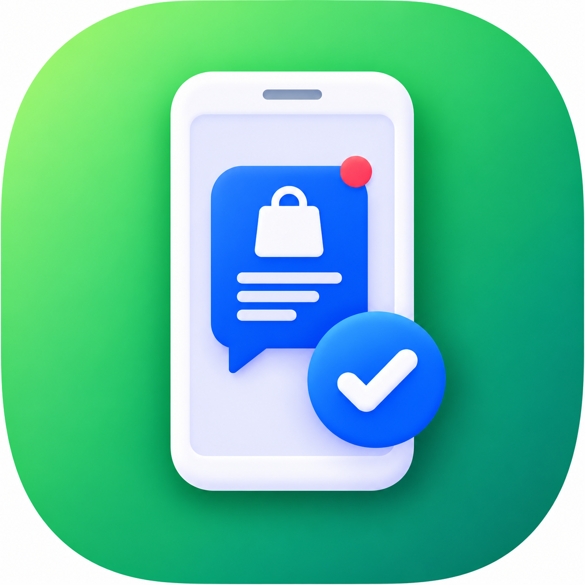

<p align="center">
  
</p>

# Bale WooCommerce Notifier

Automatically send WooCommerce order details to a [Bale](https://bale.ai) group the moment an order moves to **Processing** — with a fully customizable message template.


> The admin interface is in Persian (RTL). Dates in messages are rendered in the Jalali (Shamsi) calendar.

## Features

- **Instant order alerts** — a message is posted to your Bale group whenever an order enters the `processing` status.
- **Custom message templates** — build the message with `{placeholders}`; click any variable in the settings page to copy it.
- **Two templates** — one for normal storefront orders and one for orders an admin records manually via a "payment link" tool (selected automatically per order).
- **Receipt photo support** — for manual orders with an attached receipt image, the photo is sent with the message as its caption. If Bale rejects the photo, the plugin falls back to a plain text message so you never lose the notification.
- **Variable products** — the selected variation (e.g. color, size) is printed on its own line under the product name.
- **Order Attribution** — includes WooCommerce's built-in attribution data (UTM source, campaign, referrer, session info, …).
- **Custom order meta** — use `{meta:your_meta_key}` to insert any order meta field added by other plugins or code.
- **Jalali dates** — order dates are converted to the Persian calendar.
- **Test button** — send a sample message (built from your latest order) to verify the connection.
- **Delivery log** — the last 20 send attempts, with success/failure and the error message.

## Requirements

- WordPress 5.8 or newer
- PHP 7.4 or newer
- WooCommerce (active)
- A Bale bot token and a group the bot is a member of

## Installation

1. Download this repository as a ZIP (or clone it) and place the folder in `wp-content/plugins/`:
   ```bash
   cd wp-content/plugins
   git clone https://github.com/<your-username>/bale-woocommerce-notifier.git
   ```
2. In WordPress, go to **Plugins** and activate **Bale WooCommerce Notifier**.
3. Open the new **بله نوتیفایر** (Bale Notifier) menu item in the admin sidebar.

## Setup

### 1. Create a Bale bot

1. Open [@botfather](https://ble.ir/botfather) in Bale and create a new bot.
2. Copy the **bot token** (looks like `123456789:ABCDefgh...`).

### 2. Get your group's Chat ID

1. Add the bot to the group that should receive order notifications.
2. Find the group's Chat ID (usually a negative number such as `-1001234567890`).

### 3. Configure the plugin

1. Paste the **Bot Token** and **Chat ID** in the settings page.
2. Adjust the message templates if you like and click **ذخیره تنظیمات** (Save).
3. Click **ارسال پیام تست** (Send test message) to confirm everything works.

## Message template variables

Click a variable in the settings sidebar to copy it, then paste it into a template.

| Variable | Description |
|---|---|
| `{order_id}`, `{order_number}`, `{order_status}` | Order ID, number and status |
| `{order_date}` | Order date (Jalali) |
| `{order_items}` | Line items with price × quantity (variations on separate lines) |
| `{product_links}` | Product names with their permalinks |
| `{order_source}` | Order source (attribution, falls back to "direct") |
| `{shipping_method}` | Shipping method name |
| `{order_subtotal}`, `{order_shipping}`, `{order_total}` | Amounts (thousands-separated) |
| `{currency_symbol}` | Store currency symbol |
| `{customer_name}`, `{customer_phone}`, `{customer_email}` | Customer details |
| `{billing_state}`, `{billing_city}`, `{billing_address}`, `{billing_postcode}` | Billing address |
| `{customer_note}` | Customer's order note |
| `{payment_method}`, `{payment_method_title}`, `{payment_transaction_id}` | Payment gateway info |
| `{is_manual_order}`, `{receipt_url}` | Manual-order flag and receipt image URL |
| `{attribution_*}` | WooCommerce Order Attribution fields (`utm_source`, `utm_campaign`, `referrer`, `session_pages`, …) |
| `{meta:some_key}` | Any custom order meta value |

Example:

```
🛒 New order #{order_number}

{order_items}

Total: {order_total} {currency_symbol}
{customer_name} — {customer_phone}
{billing_city}, {billing_address}
```

If a template field is left empty, the built-in default template is used.

## How it works

The plugin hooks into `woocommerce_order_status_processing`, builds the message from the matching template, and posts it to the Bale Bot API (`https://tapi.bale.ai/bot<token>/sendMessage`, or `sendPhoto` when a receipt image applies). The result of each attempt is stored in the `bwn_log` option (last 20 entries).

## Customization notes

Some behavior is tied to the store this plugin was built for. If you use it elsewhere, you may want to adapt it:

- **Manual orders** are detected through the `_wpl_created_by` order meta and the receipt image through `_order_image`. These come from a "payment link" tool in the original theme; on a normal site no order will match, and the standard template is always used.
- **Shipping method names** are mapped to friendly Persian labels in `BWN_Notifier::get_shipping_method()` (`includes/class-bwn-notifier.php`). Unmapped methods fall back to the WooCommerce method name.

## File structure

```
bale-woocommerce-notifier/
├── bale-woocommerce-notifier.php   # Plugin bootstrap
└── includes/
    ├── class-bwn-activator.php     # Default options on activation
    ├── class-bwn-admin.php         # Settings page, test message
    ├── class-bwn-jalali.php        # Gregorian → Jalali date conversion
    └── class-bwn-notifier.php      # Message building and Bale API calls
```

## Privacy

Order details (customer name, phone, email, address, …) are sent to Bale's servers according to your template. The bot token is stored in the WordPress options table. Only include the variables you actually need in the template.

## Contributing

Issues and pull requests are welcome.

## License

Specify a license before publishing (WordPress plugins are conventionally GPL-2.0-or-later) and add a `LICENSE` file.

---

## خلاصه فارسی

**بله نوتیفایر ووکامرس** هر زمان وضعیت سفارش به «در حال انجام» (Processing) تغییر کند، جزئیات سفارش را به‌صورت خودکار در گروه بله شما ارسال می‌کند.

- قالب پیام کاملاً قابل سفارشی‌سازی با متغیرها (با کلیک روی هر متغیر کپی می‌شود)
- قالب جداگانه برای سفارش‌های ثبت‌شده توسط ادمین (لینک پرداخت) و ارسال تصویر رسید
- نمایش ویژگی‌های انتخاب‌شده محصولات متغیر در خط جدا
- تاریخ شمسی، اتریبیوشن سفارش و متای سفارشی (`{meta:کلید}`)
- دکمه ارسال پیام تست و لاگ ۲۰ ارسال آخر

**راه‌اندازی:** افزونه را فعال کنید → از منوی «بله نوتیفایر» توکن ربات (از @BotFather) و شناسه گروه (Chat ID) را وارد کنید → ذخیره کنید → پیام تست بفرستید.
